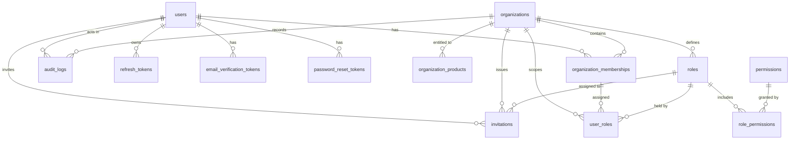

# Zentra Database Architecture & Schema

Zentra uses Neon Serverless PostgreSQL with Prisma ORM. All primary keys are UUIDs (`gen_random_uuid()`). Every tenant-owned table strictly includes `organization_id` and is guarded by PostgreSQL Row-Level Security (RLS).

---

## 1. Neon PostgreSQL Infrastructure & Dual Connections

Zentra connects to Neon PostgreSQL through two distinct database connection URLs configured in `prisma/schema.prisma`:

```prisma
datasource db {
  provider  = "postgresql"
  url       = env("DATABASE_URL")
  directUrl = env("DIRECT_DATABASE_URL")
}
```

### Connection Endpoints
1. **`DATABASE_URL` (Pooled Connection)**:
   - Contains `-pooler` in the hostname (e.g., `ep-silent-art-bdvrk9iw-pooler.c-8.us-east-2.aws.neon.tech`).
   - Uses PgBouncer in transaction pooling mode.
   - Used by the NestJS application runtime for scalable concurrent query handling.
2. **`DIRECT_DATABASE_URL` (Direct Connection)**:
   - Connects directly to the compute node without `-pooler` (e.g., `ep-silent-art-bdvrk9iw.c-8.us-east-2.aws.neon.tech`).
   - Used exclusively by Prisma Migrate (`prisma migrate dev`, `prisma migrate deploy`), Prisma Studio, and schema introspection.

### Neon Branching Workflow
- **Development & Staging Branches**: Before deploying schema changes to production, engineers create isolated Neon branches (copy-on-write database clones) to test schema migrations (`prisma migrate dev`) and verify data integrity with zero impact on production data.
- **Production Branch**: Once validated on a feature branch, migrations are applied to the primary production branch via `prisma migrate deploy`.
- **Local Development**: Docker Compose includes an optional PostgreSQL service configured with profile `offline` for local offline development only; the primary development database is Neon.

---

## 2. Row-Level Security (RLS) & Multi-Tenant Isolation

Zentra employs a defense-in-depth isolation model combining application-level filtering with PostgreSQL engine-level Row-Level Security:

1. **PostgreSQL RLS Policies**:
   - `ENABLE ROW LEVEL SECURITY` and `FORCE ROW LEVEL SECURITY` are enabled on all 18 tenant-owned tables.
   - `tenant_isolation_policy` enforces:
     ```sql
     organization_id = NULLIF(current_setting('app.current_organization_id', true), '')
     ```
   - For `roles`, the policy allows global system roles where `organization_id IS NULL`.
   - Without `app.current_organization_id` set in the session, queries return 0 rows and mutations are blocked.
2. **Limited Database Role (`zentra_app`)**:
   - A dedicated non-superuser role (`rolsuper = false`, `rolbypassrls = false`) executes application workloads and cannot bypass RLS under any circumstances.
3. **Session Tenant Context Propagation**:
   - `TenantContext` utilizes Node.js `AsyncLocalStorage` to maintain tenant state across asynchronous execution contexts.
   - `TenantContextInterceptor` intercepts authenticated requests, reads `req.user.organizationId`, and executes:
     ```sql
     SELECT set_config('app.current_organization_id', organization_id, true);
     ```
   - The transaction-local setting (`is_local = true`) guarantees that connection pool reuse never leaks tenant variables across requests.

---

## 3. Entity-Relationship Diagram



---

## Model Specifications

### 1. `users`
Global single identity per person.
- `id` (UUID, Primary Key)
- `email` (VARCHAR(255), Unique, Indexed, Normalized)
- `password_hash` (VARCHAR(255), Nullable for invited users)
- `first_name` (VARCHAR(100))
- `last_name` (VARCHAR(100))
- `is_email_verified` (BOOLEAN, Default: false)
- `status` (VARCHAR(50), Default: 'ACTIVE')
- `created_at`, `updated_at`, `deleted_at`

### 2. `organizations`
Tenants in the system.
- `id` (UUID, Primary Key)
- `name` (VARCHAR(255))
- `slug` (VARCHAR(255), Unique, Indexed)
- `status` (VARCHAR(50), Default: 'ACTIVE')
- `created_at`, `updated_at`, `deleted_at`

### 3. `organization_memberships`
Links a global user to an organization.
- `id` (UUID, Primary Key)
- `user_id` (UUID, Foreign Key -> `users.id`)
- `organization_id` (UUID, Foreign Key -> `organizations.id`)
- `status` (VARCHAR(50), Default: 'ACTIVE')
- `joined_at` (TIMESTAMPTZ)
- `created_at`, `updated_at`, `deleted_at`
- **Constraint:** UNIQUE(`user_id`, `organization_id`)

### 4. `organization_products`
Product entitlements per tenant.
- `id` (UUID, Primary Key)
- `organization_id` (UUID, Foreign Key -> `organizations.id`)
- `product_code` (VARCHAR(100), e.g., 'ZENTRA_PEOPLE', 'ZENTRA_PAYROLL')
- `status` (VARCHAR(50), 'ACTIVE', 'TRIAL', 'EXPIRED', 'CANCELLED')
- `trial_ends_at` (TIMESTAMPTZ)
- `created_at`, `updated_at`
- **Constraint:** UNIQUE(`organization_id`, `product_code`)

### 5. `roles`
Roles scoped to an organization (or global system base roles where `organization_id` is null).
- `id` (UUID, Primary Key)
- `organization_id` (UUID, Nullable Foreign Key -> `organizations.id`)
- `name` (VARCHAR(100))
- `code` (VARCHAR(100))
- `description` (TEXT)
- `is_system` (BOOLEAN, Default: false)
- `created_at`, `updated_at`

### 6. `permissions`
Granular capabilities.
- `id` (UUID, Primary Key)
- `code` (VARCHAR(100), Unique, e.g., `user.invite`, `audit.read`)
- `name` (VARCHAR(100))
- `description` (TEXT)
- `created_at`, `updated_at`

### 7. `role_permissions`
Join table mapping permissions to roles.
- `id` (UUID, Primary Key)
- `role_id` (UUID, Foreign Key -> `roles.id`)
- `permission_id` (UUID, Foreign Key -> `permissions.id`)
- `created_at`
- **Constraint:** UNIQUE(`role_id`, `permission_id`)

### 8. `user_roles`
Assigns roles to organization memberships.
- `id` (UUID, Primary Key)
- `organization_id` (UUID, Foreign Key -> `organizations.id`)
- `membership_id` (UUID, Foreign Key -> `organization_memberships.id`)
- `role_id` (UUID, Foreign Key -> `roles.id`)
- `created_at`
- **Constraint:** UNIQUE(`membership_id`, `role_id`)

### 9. `audit_logs`
Immutable audit records with sanitized values.
- `id` (UUID, Primary Key)
- `organization_id` (UUID, Nullable Foreign Key -> `organizations.id`)
- `actor_user_id` (UUID, Nullable Foreign Key -> `users.id`)
- `action` (VARCHAR(100), Indexed)
- `entity_type` (VARCHAR(100))
- `entity_id` (VARCHAR(255))
- `old_values` (JSONB)
- `new_values` (JSONB)
- `ip_address` (VARCHAR(100))
- `user_agent` (TEXT)
- `created_at` (TIMESTAMPTZ, Indexed)

### 10. `invitations`
Pending and accepted employee invitations.
- `id` (UUID, Primary Key)
- `organization_id` (UUID, Foreign Key -> `organizations.id`)
- `email` (VARCHAR(255), Indexed)
- `role_id` (UUID, Foreign Key -> `roles.id`)
- `invited_by_user_id` (UUID, Foreign Key -> `users.id`)
- `token_hash` (VARCHAR(255), Unique, Indexed)
- `status` (VARCHAR(50), Default: 'PENDING', Indexed)
- `expires_at` (TIMESTAMPTZ)
- `accepted_at` (TIMESTAMPTZ)
- `created_at`, `updated_at`

### 11. Token Tables
- `refresh_tokens`: Stores hashed refresh tokens with expiration and revocation timestamps.
- `email_verification_tokens`: Stores hashed email tokens.
- `password_reset_tokens`: Stores hashed password reset tokens.


---

### 12. Organization Setup Models (Zentra People)

#### `company_profiles`
Single company profile per organization.
- `id` (UUID, Primary Key)
- `organization_id` (UUID, Foreign Key -> `organizations.id`, Unique)
- `name`, `legal_name`, `logo_url`, `website`, `industry`, `company_size`
- `registration_number`, `tax_id_number`
- `country`, `state`, `city`, `address`, `timezone`, `default_currency`
- `primary_contact_name`, `primary_contact_email`, `primary_contact_phone`, `description`
- `created_at`, `updated_at`

#### `locations`
Headquarters and regional branch offices.
- `id` (UUID, Primary Key)
- `organization_id` (UUID, Foreign Key -> `organizations.id`)
- `name` (VARCHAR(150))
- `code` (VARCHAR(50))
- `country`, `state`, `city`, `address`, `postal_code`, `timezone`, `phone`, `email`
- `is_headquarters` (BOOLEAN, Default: false)
- `status` (`RecordStatus`: 'ACTIVE', 'INACTIVE')
- `created_at`, `updated_at`, `deleted_at`
- **Constraints:** UNIQUE(`organization_id`, `name`), UNIQUE(`organization_id`, `code`)

#### `departments`
Hierarchical tree structure with unlimited depth.
- `id` (UUID, Primary Key)
- `organization_id` (UUID, Foreign Key -> `organizations.id`)
- `name` (VARCHAR(150))
- `code` (VARCHAR(50))
- `parent_department_id` (UUID, Self-referential Foreign Key -> `departments.id`, Nullable)
- `department_head_user_id` (UUID, Foreign Key -> `users.id`, Nullable)
- `description` (TEXT)
- `status` (`RecordStatus`: 'ACTIVE', 'INACTIVE')
- `created_at`, `updated_at`, `deleted_at`
- **Constraints:** UNIQUE(`organization_id`, `name`), UNIQUE(`organization_id`, `code`)

#### `grades`
Seniority and compensation hierarchy bands.
- `id` (UUID, Primary Key)
- `organization_id` (UUID, Foreign Key -> `organizations.id`)
- `name` (VARCHAR(100))
- `code` (VARCHAR(50))
- `level` (INTEGER, Positive)
- `description` (TEXT)
- `status` (`RecordStatus`: 'ACTIVE', 'INACTIVE')
- `created_at`, `updated_at`, `deleted_at`
- **Constraints:** UNIQUE(`organization_id`, `name`), UNIQUE(`organization_id`, `code`), UNIQUE(`organization_id`, `level`)

#### `designations`
Job titles mapped optionally to departments and grades.
- `id` (UUID, Primary Key)
- `organization_id` (UUID, Foreign Key -> `organizations.id`)
- `name` (VARCHAR(150))
- `code` (VARCHAR(50))
- `grade_id` (UUID, Foreign Key -> `grades.id`, Nullable)
- `department_id` (UUID, Foreign Key -> `departments.id`, Nullable)
- `description` (TEXT)
- `status` (`RecordStatus`: 'ACTIVE', 'INACTIVE')
- `created_at`, `updated_at`, `deleted_at`
- **Constraints:** UNIQUE(`organization_id`, `name`), UNIQUE(`organization_id`, `code`)

#### `workweek_configs`
Working days and daily shift hours.
- `id` (UUID, Primary Key)
- `organization_id` (UUID, Foreign Key -> `organizations.id`, Unique)
- `weekly_working_days` (TEXT[] array of `DayOfWeek`)
- `weekend_days` (TEXT[] array of `DayOfWeek`)
- `daily_start_time` (VARCHAR(5), e.g. "09:00")
- `daily_end_time` (VARCHAR(5), e.g. "18:00")
- `break_duration_minutes` (INTEGER, Default: 60)
- `timezone` (VARCHAR(50), Default: 'UTC')
- `effective_from` (TIMESTAMPTZ)
- `created_at`, `updated_at`

#### `holidays`
Company and regional calendar holidays.
- `id` (UUID, Primary Key)
- `organization_id` (UUID, Foreign Key -> `organizations.id`)
- `name` (VARCHAR(150))
- `date` (DATE)
- `type` (`HolidayType`: 'PUBLIC', 'OPTIONAL', 'RESTRICTED')
- `location_id` (UUID, Foreign Key -> `locations.id`, Nullable for global holidays)
- `description` (TEXT)
- `is_recurring` (BOOLEAN, Default: false)
- `created_at`, `updated_at`, `deleted_at`

---

## 3. Employee Management Models

#### `employees`
Central employee master record for Zentra People.
- `id` (UUID, Primary Key)
- `organization_id` (UUID, Foreign Key -> `organizations.id`)
- `user_id` (UUID, Foreign Key -> `users.id`, Nullable for employees without portal accounts)
- `employee_code` (VARCHAR(50), Unique within organization)
- `first_name` (VARCHAR(100)), `middle_name` (VARCHAR(100)), `last_name` (VARCHAR(100))
- `work_email` (VARCHAR(255), Unique within organization)
- `personal_email` (VARCHAR(255))
- `phone` (VARCHAR(50))
- `date_of_birth` (DATE)
- `gender` (`Gender`: 'MALE', 'FEMALE', 'NON_BINARY', 'OTHER', 'PREFER_NOT_TO_SAY')
- `marital_status` (`MaritalStatus`: 'SINGLE', 'MARRIED', 'DIVORCED', 'WIDOWED')
- `blood_group` (`BloodGroup`: 'A_POSITIVE', 'A_NEGATIVE', 'B_POSITIVE', 'B_NEGATIVE', 'AB_POSITIVE', 'AB_NEGATIVE', 'O_POSITIVE', 'O_NEGATIVE')
- `nationality` (VARCHAR(100))
- Residential addresses: `current_address_line1`, `current_address_line2`, `current_city`, `current_state`, `current_country`, `current_postal_code`, `permanent_address_line1`, `permanent_address_line2`, `permanent_city`, `permanent_state`, `permanent_country`, `permanent_postal_code`
- Emergency contacts: `emergency_contact_name`, `emergency_contact_phone`, `emergency_contact_relation`
- `profile_photo_url` (TEXT)
- `date_of_joining` (DATE)
- `probation_end_date` (DATE)
- `employment_type` (`EmploymentType`: 'FULL_TIME', 'PART_TIME', 'CONTRACT', 'INTERN', 'CONSULTANT', 'TEMPORARY')
- `status` (`EmployeeStatus`: 'INVITED', 'ACTIVE', 'ON_PROBATION', 'ON_NOTICE_PERIOD', 'ON_LONG_LEAVE', 'SUSPENDED', 'INACTIVE', 'RESIGNED', 'TERMINATED', 'EXITED')
- `location_id` (UUID, Foreign Key -> `locations.id`)
- `department_id` (UUID, Foreign Key -> `departments.id`)
- `designation_id` (UUID, Foreign Key -> `designations.id`)
- `grade_id` (UUID, Foreign Key -> `grades.id`, Nullable)
- `reporting_manager_id` (UUID, Self Foreign Key -> `employees.id`, Nullable)
- `work_location_id` (UUID, Foreign Key -> `locations.id`, Nullable)
- `date_of_exit` (DATE), `exit_reason` (TEXT)
- `custom_fields` (JSONB)
- `created_at`, `updated_at`, `deleted_at`
- **Constraints:** UNIQUE(`organization_id`, `employee_code`), UNIQUE(`organization_id`, `work_email`), UNIQUE(`organization_id`, `user_id`)

#### `employment_histories`
Immutable audit log of all employee state changes and lifecycle events.
- `id` (UUID, Primary Key)
- `employee_id` (UUID, Foreign Key -> `employees.id`)
- `event_type` (`EmploymentEventType`: 'JOINED', 'TRANSFERRED', 'PROMOTED', 'DESIGNATION_CHANGED', 'REPORTING_MANAGER_CHANGED', 'LOCATION_CHANGED', 'EMPLOYMENT_TYPE_CHANGED', 'STATUS_CHANGED', 'PROBATION_COMPLETED', 'PROBATION_EXTENDED', 'RESIGNED', 'TERMINATED', 'REINSTATED', 'EXITED')
- `effective_from` (TIMESTAMPTZ)
- `effective_to` (TIMESTAMPTZ, Nullable)
- `location_id`, `department_id`, `designation_id`, `grade_id`, `reporting_manager_id`
- `employment_type` (`EmploymentType`)
- `employee_status` (`EmployeeStatus`)
- `remarks` (TEXT)
- `changed_by_user_id` (UUID, Foreign Key -> `users.id`)
- `created_at` (TIMESTAMPTZ)

#### `employee_code_sequences`
Atomic counter sequence generator for organization employee code prefixes.
- `id` (UUID, Primary Key)
- `organization_id` (UUID, Foreign Key -> `organizations.id`)
- `prefix` (VARCHAR(20))
- `next_number` (INTEGER, Default: 1)
- `padding` (INTEGER, Default: 4)
- `created_at`, `updated_at`
- **Constraints:** UNIQUE(`organization_id`, `prefix`)

#### `employee_import_jobs`
Asynchronous batch CSV employee import tracker.
- `id` (UUID, Primary Key)
- `organization_id` (UUID, Foreign Key -> `organizations.id`)
- `file_name` (VARCHAR(255))
- `total_rows` (INTEGER), `processed_rows` (INTEGER), `succeeded_rows` (INTEGER), `failed_rows` (INTEGER)
- `status` (`ImportStatus`: 'PENDING', 'PROCESSING', 'COMPLETED', 'PARTIAL_SUCCESS', 'FAILED')
- `row_errors` (JSONB)
- `created_by_user_id` (UUID, Foreign Key -> `users.id`)
- `created_at`, `updated_at`

#### `employee_export_jobs`
Audited CSV employee export record.
- `id` (UUID, Primary Key)
- `organization_id` (UUID, Foreign Key -> `organizations.id`)
- `file_name` (VARCHAR(255))
- `filter_criteria` (JSONB)
- `total_rows` (INTEGER)
- `status` (VARCHAR(50))
- `created_by_user_id` (UUID, Foreign Key -> `users.id`)
- `created_at` (TIMESTAMPTZ)

